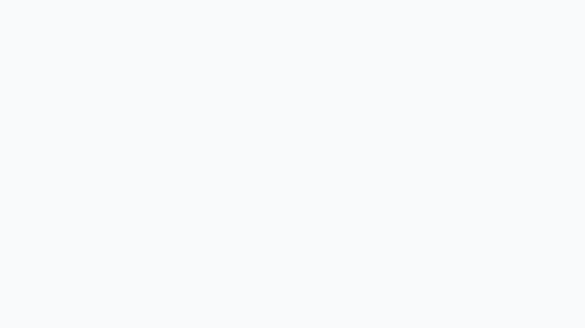
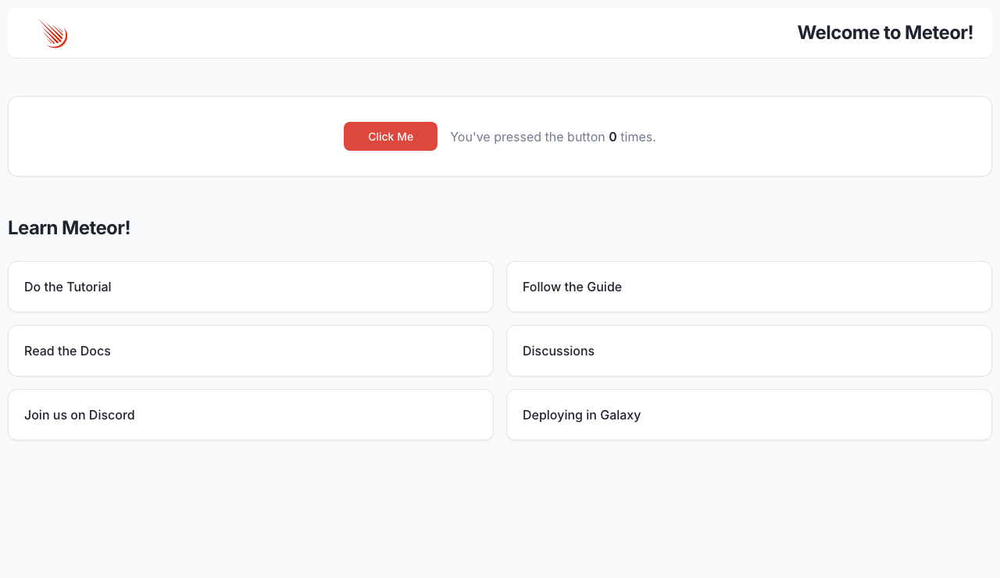

# Verification report: Meteor issue #14397

Validated on October 14, 2026, using published releases on macOS arm64.

## Verdict

The tagged-template reproduction in [meteor/meteor#14397](https://github.com/meteor/meteor/issues/14397) is fixed in **METEOR@3.6-rc.0**. The same scenario fails on **METEOR@3.5.2**, providing a positive control.

## Runtime results

| Release and mode | Default Chromium | `example` | IE11 user agent | `Googlebot` |
| --- | --- | --- | --- | --- |
| 3.5.2, production run | Pass, modern | Missing helper, legacy | Missing helper, legacy | Missing helper, legacy |
| 3.5.2, repeated production run | Pass, modern | Missing helper, legacy | Missing helper, legacy | Missing helper, legacy |
| 3.6-rc.0, production run | Pass, modern | Pass, legacy | Pass, legacy | Pass, legacy |
| 3.6-rc.0, deployment bundle | Pass, modern | Pass, legacy | Pass, legacy | Pass, legacy |

Every successful RC case returned `Meteor.release: METEOR@3.6-rc.0`, executed the tagged template, displayed `Welcome to Meteor!`, and recorded no browser page errors or failed requests. All three legacy user agents had `isModern: false`.

Both RC browser checks and the build exited with code 0. Both old-release browser checks exited with code 1. The old legacy cases returned HTTP 200, a blank React target, a null reproduction result, and:

```text
Cannot find module '@swc/helpers/_/_tagged_template_literal'
```

## Installed versions

| Component | Fixed release | Broken control |
| --- | --- | --- |
| Meteor | 3.6-rc.0 | 3.5.2 |
| Meteor Node | 26.10.0 | 24.15.0 |
| `babel-compiler` | 7.15.2-rc360.0 | 7.15.1 |
| Atmosphere `rspack` | 1.4.0-rc360.0 | 1.3.0 |
| `@meteorjs/rspack` | 3.0.0-rc.0 | 2.2.0 |
| `@rspack/core` | 2.2.9 | 1.7.12 |
| `@swc/core` | 1.16.18 | Not recorded |
| `@swc/helpers` | 0.5.23 | 0.5.23 |
| Chromium | 151.0.7922.34 | 151.0.7922.34 |

The apps retain the original npm lockfiles and `.meteor/versions` files. No `externalHelpers: false` workaround was applied. Only the reproduction and its `window` marker were appended to each client entry point.

## Source evidence

Inspected tag: `release/METEOR@3.6-rc.0`, commit `cc8cf7d21d24da5f4a4fd456527225bc5ce0e721`.

1. [Commit c67f53a](https://github.com/meteor/meteor/commit/c67f53a67c4ab7af0d465dd224cfb2ad59e61ab5), merged through [PR #14776](https://github.com/meteor/meteor/pull/14776), excludes Rspack output from automatic external-helper injection. In the tag's `packages/babel-compiler/babel-compiler.js:395–404`, the condition includes `hasSwcHelpersAvailable && !isRspackOutput`, keeping helpers added by Meteor's final legacy transformation inline.
2. [Commit 4770033](https://github.com/meteor/meteor/commit/477003308a86cb2f1e95272a79a9bafbc6a16bac) makes `tools/isobuild/import-scanner.ts:1010–1024` scan imports in legacy Rspack output. This also covers imports that could be introduced by explicit app configuration; that optional configuration was not tested here.

Both commits are ancestors of the RC tag. [PR #14721](https://github.com/meteor/meteor/pull/14721) was still unmerged when checked; this observed fix does not depend on it.

## Original evidence

- [RC production results](evidence/original-validation/production-browser-results.json).
- [RC deployment-bundle results](evidence/original-validation/built-browser-results.json).
- [3.5.2 control results](evidence/original-validation/control-352-browser-results.json).
- [Repeated 3.5.2 control results](evidence/original-validation/control-352-repeat-browser-results.json).

### Broken control with `example`



### Fixed production run with `example`



### Fixed deployment bundle with `example`


## Packaged demo verification

The packaged apps were reinstalled from their lockfiles using `meteor npm ci` and run from `apps/meteor-3.6-rc.0` and `apps/meteor-3.5.2`. The portable check explicitly enforces the expected Meteor release and modern/legacy architecture.

- [Fixed release](evidence/packaged-validation/fixed-release-browser-results.json): four successful cases; exit code 0.
- [Broken control](evidence/packaged-validation/broken-control-browser-results.json): modern passed and the three legacy cases reproduced the missing helper; exit code 1 as expected.
- [Deployment bundle](evidence/packaged-validation/built-release-browser-results.json): four successful cases after following the README's build and server commands; exit code 0.
- [Wrong-release guard](evidence/packaged-validation/wrong-release-guard-browser-results.json): expecting 3.5.2 against the working RC rejected all four cases; exit code 1 as expected.

## Limits

The checks exercise bundle selection in Chromium with altered user agents. They do not run a real IE11 engine, and no Galaxy deployment was performed. This is a focused reproduction of #14397, not a general release certification.
